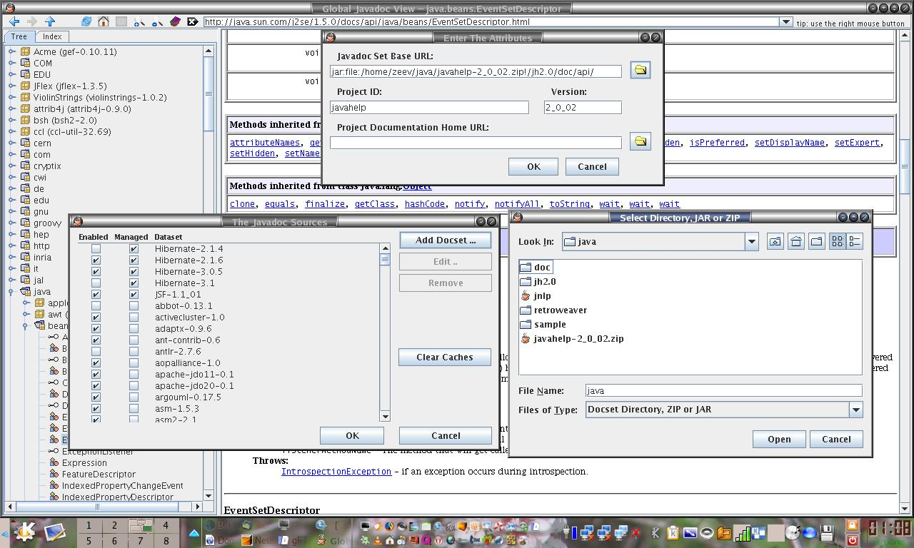

# Globaldocs

**Multiple Javadoc sets, one place to browse.**

Globaldocs is a Java Swing desktop documentation browser by **Zeev (Vladimir)
Belkin**. It brings documentation from several Java libraries into a combined
package/class tree and a searchable class index, instead of making the reader
switch between separate documentation sites.

This repository preserves a recovered **1.9.4** source snapshot of a project
developed in 2005–2007. The version is recorded in
[`properties.properties`](src/globaldocs/res/properties.properties), agrees with
the surviving 1.9.4 application JAR, and corresponds to the **6 January 2007**
entry in [`changelog.txt`](changelog.txt). The
[older public page](http://zeevbelk.in/globaldocs/) still advertises **1.4.6**;
that is a different, earlier distribution. This is an archival source release,
not a new maintained application release or a reconstruction of the CVS history.

*Historical screenshot from the original project materials, showing local ZIP
documentation and multiple docsets. It is not a screenshot of a modern Java port.*

## Features

- A combined package/class tree and alphabetical, filterable class index across
  enabled documentation sets.
- Remote documentation URLs, local directories, and Javadoc inside JAR/ZIP files.
- A docset manager for adding, editing, enabling, and disabling documentation sets.
- Bookmark links and folders, including drag and drop.
- Compressed on-disk class-index caches and a cache-clearing control.
- An embedded HTML viewer with history, page search, and zoom.
- Historical desktop integration and communication between application instances.

These capabilities are present in the source. The parser expects the older
Javadoc structure, including `allclasses-frame.html` and `overview-tree.html`;
support for current Javadoc output has not been established. See
[`docs/ARCHIVE.md`](docs/ARCHIVE.md) for the relevant code locations.

## Build and run

The source was built and smoke-tested on **Zulu OpenJDK 8u504** with
**Ant 1.10.15**, using a separately supplied legacy JNLP API JAR. The original
instructions target **J2SE 1.5+**, NetBeans 5+, and Ant. The surviving
generated Ant script now requires **Ant 1.8 or later**. A legacy-compatible JDK
and a separately obtained **JNLP API JAR** are needed; the source imports
`javax.jnlp.ServiceManager`. No third-party JARs or Java runtime are redistributed
in this repository.

See [`docs/BUILDING.md`](docs/BUILDING.md) for the checked build command, runtime
classpath, and optional Windows launcher. Exact checks and their limits are
recorded in [`docs/VERIFICATION.md`](docs/VERIFICATION.md).

Java 11 does **not** compile this snapshot unchanged: its compiler rejects the
Java 5 target, and a diagnostic compile with a newer target encounters removed
`sun.misc` Base64 classes and incompatible Swing collection types. Simply changing
the source/target settings is insufficient.

## Repository layout

| Path | Contents |
| --- | --- |
| `src/globaldocs/` | Java application sources and NetBeans GUI `.form` files |
| `src/globaldocs/res/` | Original icons, HTML help, license, and default configuration |
| `C/` | C++ source and build resources for the optional Windows launcher |
| `build.xml`, `nbproject/` | Preserved Ant/NetBeans project metadata, with private settings omitted |
| `globaldocs.jnlp`, `web/` | Historical Java Web Start deployment descriptors and web skeleton |
| `changelog.txt`, `ChangeLog`, `readme.txt` | Original release notes, CVS-derived log, and old instructions |
| `docs/` | Archive notes, build/verification details, and historical screenshot |
| `verification/` | A new, isolated archive smoke-test helper; not historical application code |
| `third-party/` | Notices and license texts for identified third-party material |

The old website deployment and signing setup is not included. The Windows
`run.exe` resource is generated from `C/`, rather than checked in. Build outputs,
CVS administration, editor backups, keystores, certificates, and private IDE
settings are excluded. The original project directory was preserved separately.

## Historical limitations

The default docset URLs and Web Start descriptors refer to old services. They
are retained as historical examples and are not a working hosted service. The
viewer uses Swing's HTML renderer and historical JDK internals; modern web-page
rendering and modern Java compatibility are not promised.

The preserved HTTPS implementation disables certificate and hostname validation
in `MainFrame.main`. Its authentication and credential-storage code has not been
modernized. Evaluation with local documentation and an isolated application
profile avoids relying on those old network/authentication mechanisms.

## License and credits

The original **Artistic License** is preserved in [`license.html`](license.html)
and in the application resources and source headers. Original author notices are
retained. This publication does not replace that license.

Identified NetBeans graphics, an execution-profile build file, and a Microsoft
sample in the Windows launcher have their own notices. Some historical artwork
has unresolved provenance; original images and their existing credits are
preserved without a claim that they have been relicensed. Details are in
[`third-party/README.md`](third-party/README.md).
